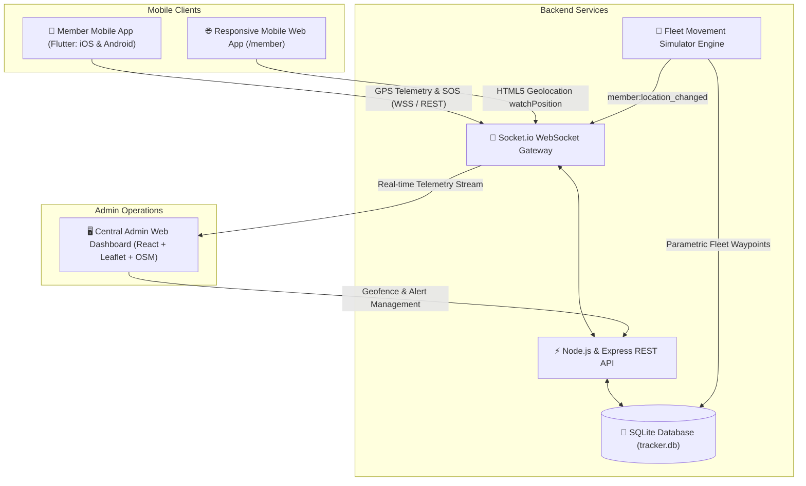

# 🧭 AWS Cloud Clubs of Ajay Kumar Garg Engineering College — Live Member Location Tracking System

A full-stack, real-time GPS tracking and member safety platform designed for **AWS Cloud Clubs of Ajay Kumar Garg Engineering College (AKGEC)**, student leaders, campus cloud community builders, hackathon teams, and event coordinators.

The system empowers club management to monitor members' real-time whereabouts on a centralized high-definition map, coordinate group logistics, establish safe-zone geofences, and receive instantaneous distress SOS alerts — while honoring complete member privacy with transparent, consent-based location sharing toggles.

---

## 🏗️ Architecture Overview



---

## 🌟 Key Features

### 1. 📱 Member Mobile App (Google Flutter)
- **Individual Authentication**: Member login via Email, Password, and Club Passcode.
- **One-Tap Location Sharing Toggle**: Explicit consent control (`LIVE ACTIVE` [Emerald Pulse] vs `PAUSED` [Privacy Protected]). When paused, zero coordinates are shared.
- **Live GPS Telemetry Dashboard**: Real-time display of Latitude, Longitude, Speed (km/h), Direction Heading, Accuracy rating (e.g. `±3.5m`), and Battery status.
- **Interactive Mini-Map**: Built-in OpenStreetMap layer (`flutter_map`) displaying the member's current GPS locator pin.
- **Emergency SOS Distress Button**: Immediate high-priority panic beacon that sends GPS coordinates to Club HQ with audible visual alerts.
- **Profile & Safety Details**: Member role, phone number, and emergency contact.
- **Background Location Support**: Configured with Android (`ACCESS_BACKGROUND_LOCATION`) and iOS (`UIBackgroundModes: location`) capabilities.

### 2. 🖥️ Central Admin Web Dashboard (React + Vite + Leaflet)
- **Live Dispatch Map**: OpenStreetMap with custom animated SVG markers, heading direction pointers, and pulsing halos.
- **Dual Map Views**: Watermark-Free OpenStreetMap Dark Tactical mode for dispatch rooms, Street View, and Satellite Imagery for outdoor campus reconnaissance.
- **Member Directory & Live Filters**: Instant filtering by status: *All*, *Sharing Live*, *Paused*, *Offline*, and *SOS Distress*.
- **Location History Trail & Breadcrumbs**: Click on any member to load their historical GPS breadcrumbs polyline with start/current pins and timestamps.
- **Geofence Zone Management**: Interactive circle overlays with configurable radius (e.g., Basecamp, Summit Checkpoint, Safe Haven) with auto-alert triggers upon entry.
- **Audible Emergency Siren**: Web Audio API synthesizer sounds an alarm the instant a member triggers an SOS.
- **Built-in Demo Fleet Simulator**: One-click simulator that streams realistic moving members along outdoor trails for instant live testing.

### 3. ⚡ Real-Time Backend Server (Node.js + Socket.io + SQLite)
- **High-Performance Database**: SQLite powered by `better-sqlite3` with WAL mode.
- **Real-Time Bidirectional WebSockets**: Low-latency `location:update`, `location:toggle`, and `member:sos` broadcasting.
- **Geofence Perimeter Computation**: Haversine distance calculation to trigger enter/exit alerts automatically.
- **Instant Mobile Web Client**: Serves `/member` directly for zero-install smartphone testing via any mobile browser.

---

## 🔑 Administrator & Member Access

| Role | Email | Password | Club Passcode | Details |
|---|---|---|---|---|
| **Club Head / Dispatch Admin** | `admin@akgec.awscloudclubs.com` | `admin123` | `AKGEC2026` | AKGEC Central Dispatch & Live Map Access |
| **Club Members / Students** | *Registered dynamically* | *Member chosen* | `AKGEC2026` | Real members register via the Mobile App or Mobile Web (`/member`) using Club Passcode `AKGEC2026` |

> Zero hardcoded members or mock locations are stored in the system. When new members register and toggle location sharing ON, they appear live on the dispatch map in real-time.

---

## 🚀 Quick Start Guide

### 1. Start Backend Server
```bash
cd server
npm start
```
- Server will run on: `http://localhost:5000`
- Mobile Web Client: `http://localhost:5000/member`

### 2. Start Admin Dashboard
```bash
cd admin-dashboard
npm run dev
```
- Open `http://localhost:5173` in your browser.
- Sign in with `admin@akgec.awscloudclubs.com` / `admin123`.

### 3. Run Flutter Member Mobile App
```bash
cd member_app
flutter run
```
*Supports Windows desktop, Chrome/Edge web, and connected Android/iOS phones.*

To build an Android APK:
```bash
cd member_app
flutter build apk --release
```

---

## 📡 REST API Reference

| Method | Endpoint | Description |
|---|---|---|
| `POST` | `/api/auth/admin/login` | Admin authentication |
| `POST` | `/api/auth/member/login` | Member login |
| `POST` | `/api/auth/member/register` | Register new club member |
| `GET` | `/api/members` | Get all club members with latest telemetry |
| `GET` | `/api/members/:id/history` | Get GPS breadcrumbs trail (hours / limit) |
| `POST` | `/api/members/:id/sharing` | Toggle location sharing consent (ON/OFF) |
| `GET` | `/api/geofences` | Get club geofence safe zones |
| `POST` | `/api/geofences` | Create a new geofence zone |
| `DELETE` | `/api/geofences/:id` | Delete a geofence zone |
| `GET` | `/api/alerts` | Get recent alerts & SOS distress logs |
| `POST` | `/api/alerts/sos` | Trigger emergency SOS distress beacon |
| `PUT` | `/api/alerts/:id/resolve` | Mark alert as resolved |
| `POST` | `/api/simulator/toggle` | Start or stop demo fleet movement simulator |
| `GET` | `/api/system/status` | System health & telemetry counters |

---

## 🔒 Privacy & Safety Notice
Location tracking in this application is strictly **opt-in** and **transparent**:
1. Members maintain full control: turning the switch OFF immediately ceases all GPS transmission.
2. A prominent status beacon clearly indicates whenever location data is being streamed.
3. Only authorized administrators authenticated with club credentials can access the central live map.

